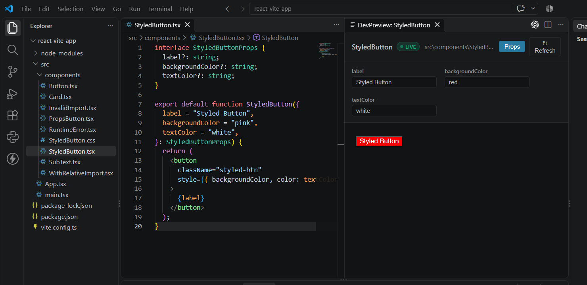

# DevPreview

**Your React components. Live in your editor. No setup required.**

Stop creating temporary routes, modifying `App.tsx`, or manually wiring components just to see how they look. DevPreview lets you preview React components directly inside Visual Studio Code, right where you write your code.

DevPreview is a Visual Studio Code extension that lets you inspect and preview React components directly inside your editor. Explore component rendering, test props interactively, and iterate on your UI without repeatedly navigating away from your code.

## See It in Action

## Why DevPreview?

- **No `App.tsx` changes** — Preview individual components without adding them to your main application.
- **No routing setup** — No temporary routes or dedicated preview pages.
- **No manual imports** — Skip the repetitive work of wiring components into your app just to test their appearance.
- **Interactive Props** — Experiment with supported component props directly in the preview panel.
- **Fast Iteration** — Refresh your preview and refine your UI without disrupting your application.
- **Styles and Imports** — Support component CSS and relative imports where compatible.
- **Built for React** — Preview supported JSX and TSX components in your existing project.

## Features

- **Instant component preview:** Preview individual `.jsx` and `.tsx` files inside VS Code.
- **Default and named exports:** Detect supported component exports.
- **Live preview:** Render components in an isolated preview environment.
- **Props inspection:** Adjust supported component props to explore different UI states.
- **CSS and relative imports:** Preview components that use stylesheets and local imports.
- **Error handling:** Display preview errors without intentionally modifying your original application files.
- **Concurrent previews:** Run multiple preview sessions independently.
- **Project protection:** Create temporary preview files rather than replacing the application's original entry point.

## Get Started

1. Install [DevPreview from the Visual Studio Marketplace](https://marketplace.visualstudio.com/items?itemName=ahaydenanand.devpreview).
2. Open your React project in VS Code.
3. Open the component you want to preview.
4. Press `Ctrl + Shift + P` and search for `DevPreview`.
5. Run the available preview command and view your component in the preview panel.

That's it. No need to modify your application's entry point or create a separate page just to preview a component.

### How to use

1. Open a React project in VS Code.
2. Make sure the project's dependencies are installed.
3. In the Explorer or editor, right-click a `.jsx` or `.tsx` file.
4. Select **DevPreview: Preview Component**.
5. Inspect the component in the preview panel.

## Requirements

- Visual Studio Code
- Node.js and npm
- A React project with its dependencies installed

Vite-based React projects are the primary target.

## Privacy

DevPreview creates a local preview environment for rendering components. Review the extension's implementation and your project's dependencies before previewing untrusted code. Do not assume that running project code is risk-free.

---

**DevPreview — Preview components, not plumbing.**